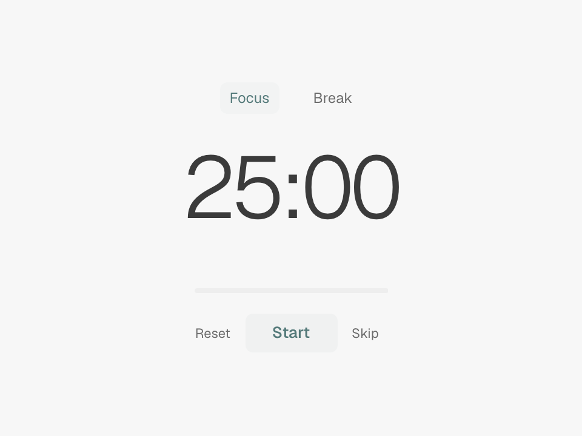

# Pomodoro for Tern

A minimal native timer block: 25 minutes of focus and 5 minutes to recharge by default. Borderless, theme-aware, and lightly tinted, with a quiet progress line. No network access, subprocesses, or external dependencies.



## Install and open

Requires [Tern](https://docs.stencil.so/tern/) with Luau plugin support and Git on your PATH. Tested on Tern 0.7.0 on macOS.

```sh
tern plugin install https://github.com/tcstacks/tern-pomodoro
```

In Tern's command palette, choose **New Pomodoro block**. Each block has an independent timer and completed-focus count. From a window plugin, use `cx:new_block("pomodoro.timer")`; the manifest adds the palette entry without a window plugin.

### Versioned releases

Download `tern-pomodoro-v1.0.0.tar.gz` from [Releases](https://github.com/tcstacks/tern-pomodoro/releases), extract it, then install the extracted directory:

```sh
tar -xzf tern-pomodoro-v1.0.0.tar.gz
tern plugin install ./tern-pomodoro
```

Each release includes `SHA256SUMS` to verify the archive.

### Update or uninstall

```sh
# Update an installed copy to the latest source.
tern plugin install https://github.com/tcstacks/tern-pomodoro --force

# Remove the plugin.
tern plugin remove pomodoro
```

`--force` does not overwrite development links. If you previously linked this plugin, run `tern plugin unlink pomodoro` before installing a copy. Close active Pomodoro blocks before updating or uninstalling.

## Controls

- **Start / Pause / Resume** or **Space / Enter**: control the current interval.
- **Click the countdown**: edit the current phase's duration in whole minutes, from **1 to 180**. The value starts selected; type to replace it. **Enter / Save** applies a fresh, stopped interval. **Escape / Cancel** discards the draft.
- **Reset** or **R**: reset the current phase to its chosen duration, leaving it stopped.
- **Skip** or **N**: move to the next phase, leaving it stopped. Skipped focus intervals do not count as completed.
- **Focus / Break**: select a phase. Changing phase resets and stops the timer; selecting the current phase leaves it alone.

Focus and break durations are independent and saved per block. Opening the editor pauses a running interval; cancelling keeps its remaining time paused. Switching phases discards an open draft. Timer shortcuts do not run while editing. Invalid durations keep the editor open with an inline message. Native text selection is supported; keyboard editing also works when Tern's native composer editing is disabled. This is click-to-edit, not drag-to-adjust: Tern's current native block API does not expose pointer movement.

Editing crossfades within a fixed layout, with matching typography and aligned controls. Reduced motion disables the transition. Inactive layers cannot intercept clicks and are hidden from accessibility.

On completion, the block stays at `00:00`, sends a Tern toast, and offers **Start break** or **Start focus**. It never starts another interval unattended. The completed-focus count belongs to the block, not to a day or shared global history. Closing the block stops its timer.

Expiry sends a brief full-block wave using Tern's native bell ripple, accompanied by a subtle tint. Reduced motion shows only the tint. The effect never intercepts input, clears after 1.3 seconds, and does not replay on reload.

Running timers use an absolute wall-clock deadline, not accumulated ticks. Time spent asleep or with windows closed still counts. On restoration, an overdue timer completes once; it does not invent missed focus/break cycles. Manual system clock changes affect the deadline. This is a Tern toast, not an OS alarm while Tern is shut down.

Tern persists chosen durations, the deadline, paused time, phase, and completed count. Existing blocks retain their interval and receive default phase lengths. Draft text is transient: reloading during an edit leaves the timer paused without applying the draft. Only running timers have a repeating callback.

## Development

Clone the repository and link your working copy:

```sh
git clone https://github.com/tcstacks/tern-pomodoro
cd tern-pomodoro
tern plugin link .
```

- `host.luau`: block lifecycle, native view, controls and timer scheduling.
- `timer.luau`: deadline-based state transitions and serialization.
- `duration-input.luau`: numeric draft, selection, and keyboard editing.
- `styles.css`: styling scoped to `plugin.pomodoro.timer`.
- `timer.spec.luau`: deterministic state-transition regression checks.

Tern reloads a linked package on save. For a manual reload, run `tern plugin reload`.

Generate types matching your installed Tern with `tern plugin types .`. If luau-lsp is available:

```sh
luau-lsp analyze --platform=standard --definitions=@tern=tern.d.luau host.luau timer.luau duration-input.luau timer.spec.luau
```

Run model regressions with the Luau CLI:

```sh
luau timer.spec.luau
```

Alternatively, load `require("./timer.spec")` in a temporary Tern host entry alongside the model. The checks use explicit timestamps, with no real-time waits.

Tested with Tern 0.7.0. Model checks cover deadline boundaries, custom durations, validation without mutation, restoration, and independent blocks. Native UI smoke checks cover editing with and without native text selection, pause/reset/skip, persistence, expiry, transition alignment, and reduced motion.

## License

[MIT](LICENSE) © 2026 tcstacks.
